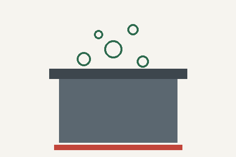

# Boiling water to make it safe

Boiling is the most reliable way to kill germs in water at home when the tap supply is unsafe.

## How to do it

1. If the water is cloudy, let it settle and pour it through a clean cloth first.
2. Bring it to a **rolling boil** (big bubbles that keep coming even when stirred).
3. Keep it boiling for **1 minute**; above 2,000 m (6,500 ft), boil for **3 minutes**.
4. Let it cool in the covered pot, then pour it into clean containers.

## What boiling does not fix

Boiling kills germs, but it does not remove chemicals, fuel or heavy metals. Water that may be
contaminated with those needs a different source.

See also [storing water](storing-water.md).
